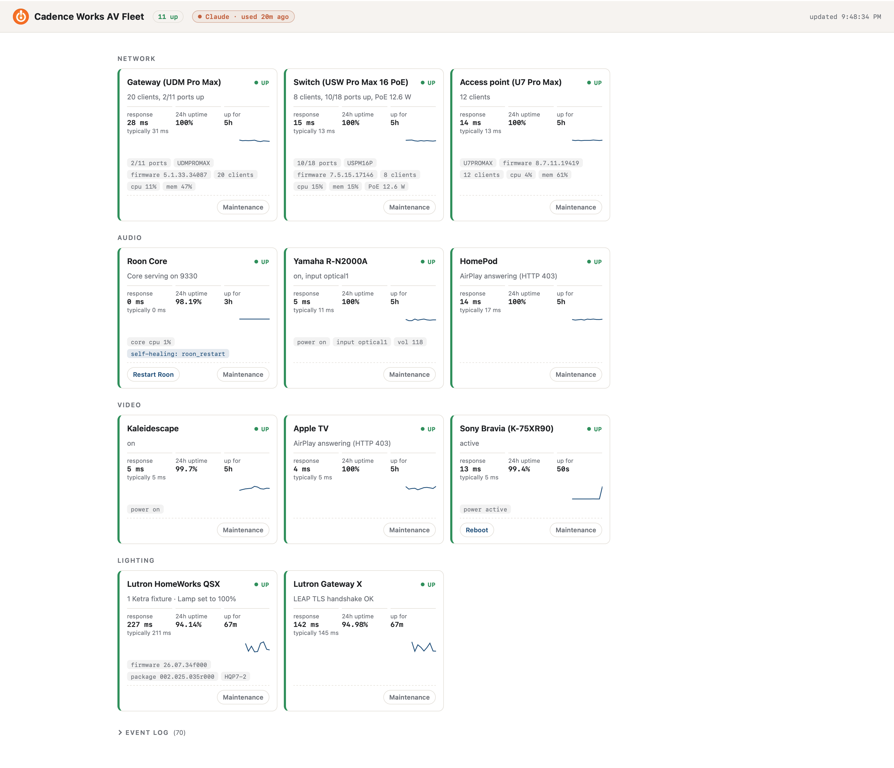
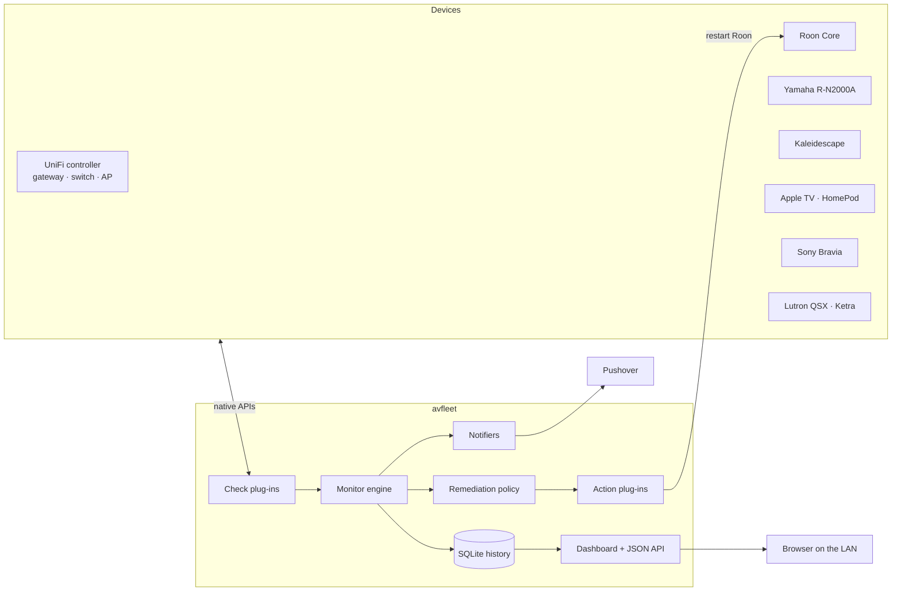
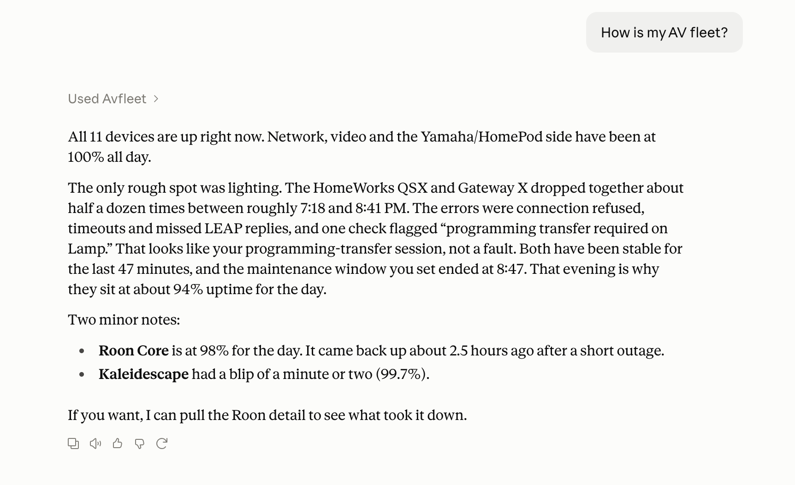

# avfleet

[](https://github.com/JonathanLaneTech/avfleet/actions/workflows/ci.yml)

**Health monitoring, alerting and self-healing for an AV and network fleet.**

My Roon music server kept hanging after software updates, and the fix was always the same:
notice, then restart it by hand. avfleet started as a small script that did that restart
automatically, and grew into a monitor for the whole system. It watches every device,
pages me when something breaks, fixes known failures on its own, and lets Claude explain
what happened.



Under the hood, avfleet checks each device the way a user depends on it: not "does it answer
ping" but "is the service actually working". It asks the Yamaha for its status over Yamaha
Extended Control, the Kaleidescape over its control protocol, the TV over its REST API, the
switch over the UniFi controller API, and the Lutron processor over LEAP. The original script
had no history, no view of the rest of the system, and no room for a second fix; avfleet is
that idea rebuilt as a small platform: pluggable checks, pluggable actions, one policy engine,
and tests.

## Try it without any hardware

```bash
git clone https://github.com/<you>/avfleet && cd avfleet
python3 -m venv .venv && . .venv/bin/activate
pip install -e ".[dev]"
avfleet demo            # open http://127.0.0.1:8080
```

The demo runs the real monitor against simulated devices that speak each device's real
protocol, with 24 hours of backfilled history. After 30 seconds the simulated Roon Core
"crashes". Within three checks you'll see it detected, alerted, restarted and recovered
in the event log.

## Architecture



| Component | File | Responsibility |
|---|---|---|
| Checks | `src/avfleet/checks/` | One class per device type. Answers "is it working?" and returns a `CheckResult` (status, latency, detail, metrics). Never raises. |
| Engine | `src/avfleet/engine.py` | Runs checks concurrently on an interval, records results, turns them into state changes, alerts and remediation. |
| Policy | `RemediationPolicy` in `engine.py` | Decides *whether* an action may run: debounce, cooldown, hourly limit. Actions never decide this themselves. |
| Actions | `src/avfleet/actions/` | Self-healing steps with a safety precondition (`should_run`) and an effect (`execute`). Local or over SSH. |
| Store | `src/avfleet/store.py` | SQLite history: results and events, uptime and latency queries, pruning. |
| Dashboard | `src/avfleet/web/` | Standard-library HTTP server, `/api/status` JSON, a dependency-free page. Reads only from the store. |
| Notifiers | `src/avfleet/notifiers.py` | Pushover and log output; add more by type. |

Design choices worth calling out:

- **Functioning, not just reachable.** Each check exercises the service people use (AirPlay, YXC, the Kaleidescape control port), so "UP" means usable.
- **Four states.** `up`, `degraded` (reachable but impaired, e.g. a required switch port lost link), `down`, and `unknown` (the check couldn't run, e.g. missing credentials). Only `down` pages anyone.
- **Debounced alerts.** A device is declared down after `fail_threshold` consecutive failures (default 3), one alert per outage, and one recovery message.
- **Guarded self-healing.** Remediation runs only after N failures, at most once per cooldown and `max_per_hour` times an hour. When the budget runs out it stops and asks for a human. The Roon restart also refuses to run while the Core is busy, because that usually means a database upgrade is in progress, and killing it would cause the outage it's trying to fix.
- **Zero runtime dependencies.** Standard library only (Python 3.11+), so it installs cleanly on the Mac mini that already runs the Roon Core.
- **The dashboard is decoupled.** It reads history from SQLite. If the monitor loop stalls, the page says so instead of silently showing stale green tiles.

## Health checks

| Device | Type | Protocol | What "up" means |
|---|---|---|---|
| UDM Pro Max, USW Pro Max 16 PoE, U7 Pro Max | `unifi_device` | UniFi Network API (`/proxy/network/api/s/<site>/stat/device`) via a local read-only account | Device adopted and connected; reports clients, CPU/memory, port link count, PoE draw vs. budget, available updates. Required ports (`expected_up_ports`) without link → degraded. |
| Roon Core | `roon` | TCP to the Core's service port, plus local process and CPU inspection | Core accepting connections. |
| Yamaha R-N2000A | `yamaha_yxc` | Yamaha Extended Control `GET /YamahaExtendedControl/v1/main/getStatus` | `response_code` 0; reports power, input, volume. Standby is healthy. |
| Kaleidescape | `kaleidescape` | Kaleidescape control protocol, TCP 10000, `GET_DEVICE_POWER_STATE` | Replies with status 000; reports on/standby. Unsolicited events are skipped by matching sequence numbers. |
| Apple TV, HomePod | `apple_tv`, `homepod` | AirPlay `GET /info` (TCP 7000), binary plist | AirPlay service answering; reports model and OS build. |
| Sony Bravia (K-75XR90) | `tv` (`protocol = "sony_bravia"`) | Bravia REST `POST /sony/system getPowerStatus` with pre-shared key | API answers; reports active/standby. Samsung and generic TCP adapters included. |
| Lutron HomeWorks QSX and its Ketra fixtures | `lutron_leap` | LEAP over mutual TLS, port 8081 | **Paired:** walks the processor's own view (project → devices → Clear Connect X link nodes → per-device status → zones) and reports every Ketra fixture, its zone level and colour temperature, processor firmware, and pending programming transfers. Any fixture the processor marks `Unavailable` → degraded, named on the tile. **Unpaired** (e.g. a Gateway X): TLS handshake. |
| Anything else | `tcp`, `http` | TCP port / HTTP status | Port open / expected status code. |

> Protocol details for Kaleidescape replies and the Roon port reflect public documentation
> and should be confirmed against your firmware; both checks are written to be tolerant.

## Configuration

Copy `config.example.toml` to `config.toml` (git-ignored) and edit it. Secrets never go in
the config: values like `${UNIFI_PASSWORD}` are filled from the environment, and an
`env_file` (KEY=VALUE, `chmod 600`) is loaded first so the launchd service gets them too.

```toml
[[devices]]
id = "roon"
name = "Roon Core"
type = "roon"
host = "127.0.0.1"
group = "Audio"
[devices.options]
port = 9330
local = true
[devices.remediation]
action = "roon_restart"
after_failures = 3
cooldown_s = 900
max_per_hour = 3
```

For UniFi, create a local (not Ubiquiti cloud) user on the console with a read-only role.

For Lutron, pair once with `lap-pair` from the open-source
[pylutron-caseta](https://github.com/gurumitts/pylutron-caseta) project:

```bash
pip install "pylutron-caseta[cli]"
lap-pair <processor-ip>     # writes certificates to ~/.config/pylutron_caseta/
```

avfleet finds those certificates automatically for a `lutron_leap` device with the same host.
LEAP has no read-only pairing, so the certificate could control lights; avfleet only ever sends
`ReadRequest`s, and deliberately never reads `/link/<id>`, which on Clear Connect X links
contains the radio network's master key.

**Field finding:** a HomeWorks QSX reports the level and colour it last *commanded* for a Ketra
zone, not what the fixture is doing, and it does not expose fixture presence over LEAP. With a
Ketra A20 unpowered for ten minutes, `Availability` stayed `Unknown` and the zone kept reporting
100% / 3500 K. The dashboard therefore says "set to" rather than implying the light is confirmed on.
If a processor does report `Unavailable`, the tile turns degraded and names the fixture.

The dashboard can carry your own name and logo, so an integrator can deploy it under their brand:

```toml
[web]
title = "Your Company AV Fleet"
logo = "~/.avfleet/logo.png"   # .png, .svg, .jpg or .webp
```

## Running it

```bash
avfleet check -c config.toml          # one pass, table output, exit 1 if anything is down
avfleet run -c config.toml            # monitor + dashboard on http://<host>:8080
avfleet run -c config.toml --dry-run  # log what self-healing would do, don't do it
```

On macOS, `bash deploy/install-macos.sh ~/.avfleet/config.toml` creates a virtualenv,
installs avfleet and registers a launchd agent that starts at login and restarts if it
exits. It runs in the user session so the Roon restart can quit and relaunch the app.

## Maintenance mode

When you're working on something, tell avfleet so it doesn't page you or try to fix it.
The quickest way is the **Maintenance** button on the device's tile: pick 15 minutes to
2 hours, and the button becomes **End maintenance**. The same is available from the command line:

```bash
avfleet maintain -c config.toml lutron 30m --reason "programming transfer"
avfleet maintain -c config.toml all 1h --reason "network firmware"
avfleet maintain -c config.toml --list
avfleet maintain -c config.toml --end lutron
```

During a window the device is still checked and shown live, but alerts and self-healing are
paused and those checks are excluded from uptime. The tile turns purple with the end time and
reason. When the window ends, failure counting starts fresh, so a device that's still broken
pages normally after `fail_threshold` checks. Devices that announce their own maintenance get
an automatic notice on the tile: UniFi "Firmware updating", a Lutron programming transfer,
or a Roon Core busy updating its library (self-healing waits for it).

Opening or closing a maintenance window is the only change the dashboard can make. Requests
must be JSON from the dashboard's own origin, so another web page can't trigger them, and on a
network shared with guests or IoT devices you can require a PIN:

```toml
[web]
pin = "${AVFLEET_PIN}"   # the dashboard asks for it once per browser
```

## Reboot buttons

Devices that tend to lock up can get a button on their tile:

```toml
[[devices]]
id = "tv"
type = "tv"
# ...
[devices.reboot]
action = "bravia_reboot"   # Sony's REST API requestReboot
label = "Reboot"
cooldown_s = 300
```

Built in: `bravia_reboot` (Sony Bravia) and `roon_restart` (the Roon app, with its "not while
the Core is upgrading" check). Every press asks for confirmation, honours the cooldown, and is
logged with who asked ("via dashboard" or "via Claude").

In a commercial install, the universal answer is an IP-controlled power device (WattBox,
SurgeX, Panamax/BlueBOLT, Middle Atlantic), which can power-cycle anything with a plug,
including devices whose makers offer no network reboot (an Apple TV, for instance). A reboot is
just an action plugged into `[devices.reboot]`, so a power-cycle driver for one of those
becomes a "Power cycle" button on any device without other changes.

## Ask Claude: the MCP server

`avfleet mcp` turns the fleet into an [MCP](https://modelcontextprotocol.io) server, so Claude
can answer questions about it ("is everything healthy?", "why did Roon go down last night?",
"is the theater ready?") and, if you allow it, take actions.



*Above: asked "is everything healthy?", Claude reads avfleet's status and event history and
works out that a Lutron processor's bounces lined up with programming transfers and their
maintenance windows, rather than reporting a fault.*

| Tool | Kind | What it does |
|---|---|---|
| `fleet_status` | read | Every device's status, detail, response time, 24 h uptime, maintenance, notices |
| `device_detail` | read | One device: metrics, uptime and **outage windows** over a period, recent events |
| `recent_events` | read | The event log, filterable by device, kind and time |
| `list_keypad_buttons` | read | Lutron keypad buttons and their engravings, by room |
| `start_maintenance` / `end_maintenance` | action: `maintenance` | Open or close maintenance windows |
| `run_self_healing` | action: `self_healing` | Run a device's configured fix now (e.g. restart Roon), with its safety check and cooldown |
| `reboot_device` | action: `reboot` | Press a device's reboot button (cooldown and confirmation as on the dashboard) |
| `press_keypad_button` | action: `lutron_buttons` | Press a programmed Lutron keypad button (e.g. start a Natural Show) |

Read tools are always available and annotated read-only. Actions are **opt-in by kind**;
a kind that isn't listed doesn't exist as far as Claude can see:

```toml
[mcp]
actions = ["maintenance"]                       # the default
# actions = ["maintenance", "self_healing", "reboot", "lutron_buttons"]
```

Every action is logged as "via Claude" in the event log, button presses are limited to
buttons that exist in the processor's own programming, and MCP clients ask you to approve
each tool call.

**Claude Desktop, with avfleet on another machine.** The server speaks MCP over stdio, so
Claude Desktop can start it over SSH; nothing is exposed to the network. Set up key-based SSH
to the monitoring host, then in Claude Desktop open **Settings → Developer → Edit Config**:

```json
{
  "mcpServers": {
    "avfleet": {
      "command": "ssh",
      "args": ["-T", "-o", "BatchMode=yes", "user@monitor-host",
               "~/.avfleet/venv/bin/avfleet mcp -c ~/.avfleet/config.toml"]
    }
  }
}
```

Restart Claude Desktop and avfleet appears under connectors. Once Claude has used it, the
dashboard header shows a "Claude · used 3m ago" badge (hover for what it's allowed to do), and
the event log's **Claude** filter lists everything Claude has done. Tool output includes each
device's *typical* response time, so Claude judges a slow-protocol device (an encrypted Lutron
session) against its own normal rather than against a fast HTTP device. The server is standard-library
Python and is tested against the official MCP client library.

## Extending

A new device type is one class:

```python
from avfleet.checks.base import Check, http_request, register
from avfleet.models import Status

@register("my_projector")
class ProjectorCheck(Check):
    def probe(self):
        resp = http_request(f"http://{self.device.host}/api/status", self.device.timeout_s)
        lamp = resp.json()["lamp_hours"]
        status = Status.DEGRADED if lamp > 18000 else Status.UP
        return self.result(status, f"lamp {lamp} h", latency_ms=resp.latency_ms, metrics={"lamp_hours": lamp})
```

A new self-healing step is one class with a precondition and an effect, registered with
`@register_action("name")`. It inherits debounce, cooldown, rate limiting, dry run, event
logging and alerting from the engine.

## Tests and CI

```bash
pytest        # 60+ tests, about 15 s, no network access needed
ruff check .
```

Every check is tested against in-process fake devices: an HTTP server that answers like
YXC, AirPlay, Bravia and the UniFi controller (including session expiry and re-login), and
a TCP server that speaks the Kaleidescape protocol with unsolicited events mixed in. The
engine's alerting and remediation rules are tested with a fake clock. One end-to-end test
runs the whole fleet through a crash and self-heal. A config test fails the build if the
example config ever contains a non-documentation IP address, a real-looking MAC, or an
inline secret.

GitHub Actions runs lint and tests on Ubuntu and macOS across Python 3.11 to 3.13.

## Security notes

- Real addresses, MACs and credentials live only in the git-ignored `config.toml` and `secrets.env`.
- Device accounts are read-only where the platform allows (UniFi local read-only role).
- The dashboard has no authentication. Bind it to the LAN (or `127.0.0.1`) and reach it remotely over a VPN, never by port forwarding.
- Device-supplied text is rendered with `textContent` only, and the static file server rejects anything but its own files.

## Roadmap

- Savant and Control4 controller checks
- SNMP for non-UniFi network gear; Prometheus `/metrics` endpoint
- Per-room rollups ("Theater: ready") built from device dependencies
- Power-cycle drivers for IP power (WattBox, SurgeX) and PoE ports through the UniFi API

## License

MIT
